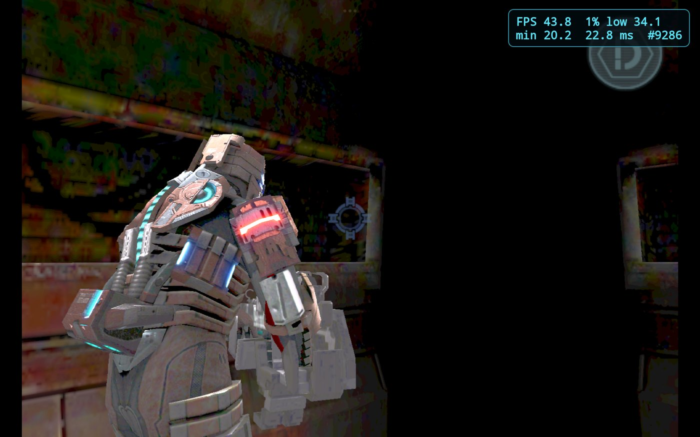

# 暗部增强实验：已弃用，默认 0%

日期：2026-10-26。用户决定保留当前实现与开关，默认关闭，标注弃用并归档发现。

## 结论与证据

- 用户提供的 iOS 原生截图也有同样的大片黑暗；旧安卓构建也如此。目标是改善原生可见度，不能把它表述为本次移植新增的黑屏或深度缺陷。
- 关闭 fog 后，用户在同一位置复测仍黑。该次对照不能支持“雾导致过黑”的解释；候选 APK 已恢复正常 fog。
- 原始游戏帧与最终截屏对照：天花板区域 RGB 全零像素约 83.07% / 81.90%，前墙约 64.71% / 63.47%；两个区域亮度中位数均为零。地板中位亮度约 56.12 / 56.19。这说明所选区域在最终显示处理之前就已很黑，不是只在截屏或最终呈现时丢失。
- 用户将增强调至 100% 后报告“其他地方都失真了，还是黑的”。实际 ADB 截屏显示：目标区域仍大片纯黑，其他暗部出现明显彩色失真/色阶。视觉验收未通过，不再推荐此曲线解决目标问题。
- 后处理无法从 RGB=(0,0,0) 恢复不存在于输入帧中的细节。增强可能放大近黑量化误差和色偏；这是对失真机制的推断，尚未定位到具体素材或光照计算。

## 保留的实现与默认行为

- 保留共享呈现 shader、`uShadow`、`shadowLift`、环境变量 `TOUCHHLE_DS_SHADOW_BOOST`（0..1），以及安卓 ES2 呈现路径接入。
- 保留安卓启动器 0/30/60/100% 循环开关，按钮与说明标注“已弃用”；不再使用“温和/最强”等效果推荐措辞。
- Rust 环境变量缺省、安卓首启偏好缺省、Activity 缺少 intent 参数时的回退全部为 0%；“恢复默认”也设为 0%。已显式保存的非零选择仍保留，需手动切回 0%。
- 光柱遮挡修复和已接受的材质高光校正保持原样。此次 Git 提交不纳入它们或其他未提交工作的改动。
- PC 仅保留共享 shader 源码，没有为此实验交付新的 PC 二进制或 PC 启动器开关。
- 这次归档没有重新构建、安装或重启平板；正在运行的旧候选不会因源码默认值修改而即时改变。

## 验证与局限

此前 Android 优化 release 构建成功（约 2 分 54 秒）；仅 arm64，签名校验通过；同测试包覆盖安装后核对 23 个存档文件未变化。被否定的实验 APK SHA-256：`eb2b09e9d91531c4f46037a81c9ce02fa2ebf32f3f574093fe3de01ba712fd0e`，当时默认值为 30%，不能当作本次默认 0% 的发布产物。

Mesa llvmpipe GLES 测试曾确认生产 shader 编译/链接成功、关闭时恒等、纯黑和 alpha 保留、153..255 灰阶高光不变、各档灰阶单调。它们只验证数学行为，未覆盖实际暗部视觉质量；不能替代上述失败的人眼验收。当前改动只调整默认值、标注与文档，保留原曲线，未重做完整构建或效果验收。

后续若重新研究，应先定位场景材质/纹理/光照阶段是否还有可恢复信息，再决定是否做可选的局部改善；本文件不声称已实现该方向，也不预设所有黑区都有隐藏细节。

## 归档文件

同目录 `shadow-evidence/` 包含 100% 截图缩略图、原始帧/显示帧区域统计、此前 GPU 数学测试结果。外部完整原图、脚本、日志和 APK 保存在 `E:/CodexProjects/DeadSpaceLegacy/report/unified-offline-20261026` 及对应 `dist/android-shadow-enhancement-20261026`；Git 不收录大体积二进制。

归档证据 SHA-256：

- `tablet-shadow-100-reference-small.jpg`：`62572086e6353271931ee32695fd8e89f772fa224b7c3c9fb456e58c663c390a`
- `tablet-dark-raw-vs-final.json`：`ea0e0d3f2132963721f28c9c25e3b209cf497f5be8bf9a0afd2189bf47a021d2`
- `shadow-shader-gpu-tests.json`：`c216bf3dd6e210470632e74f0863dd3930f9c286c83303abdd1a3ed4eea58117`
