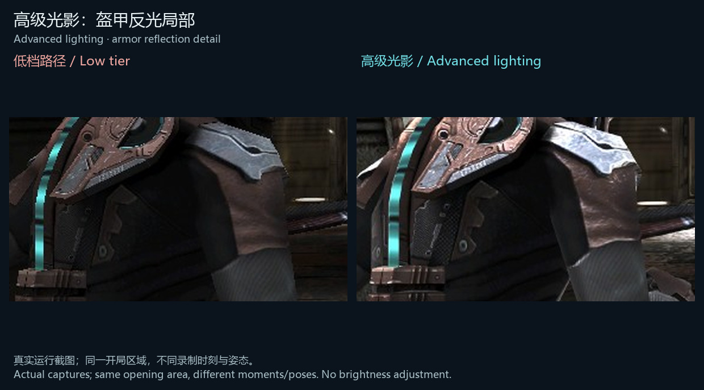
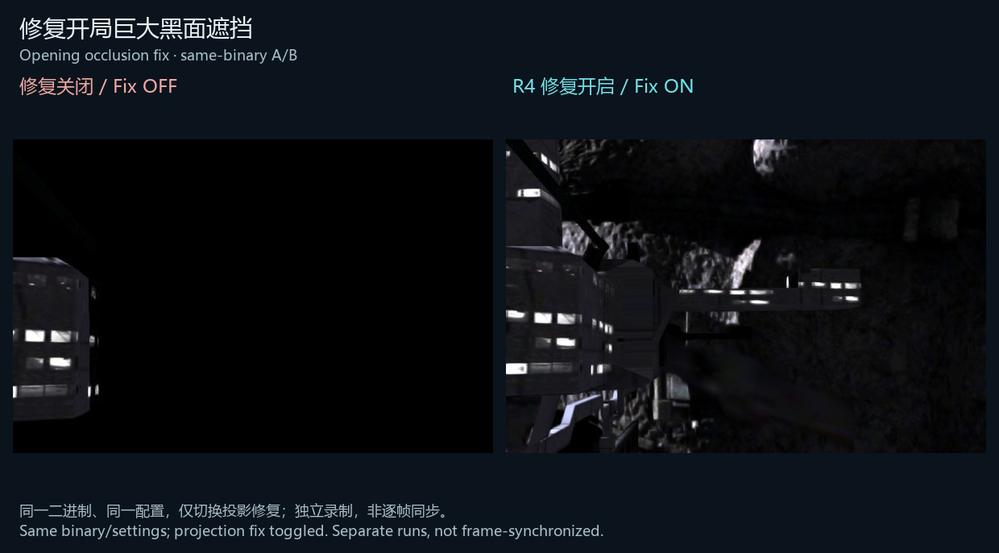
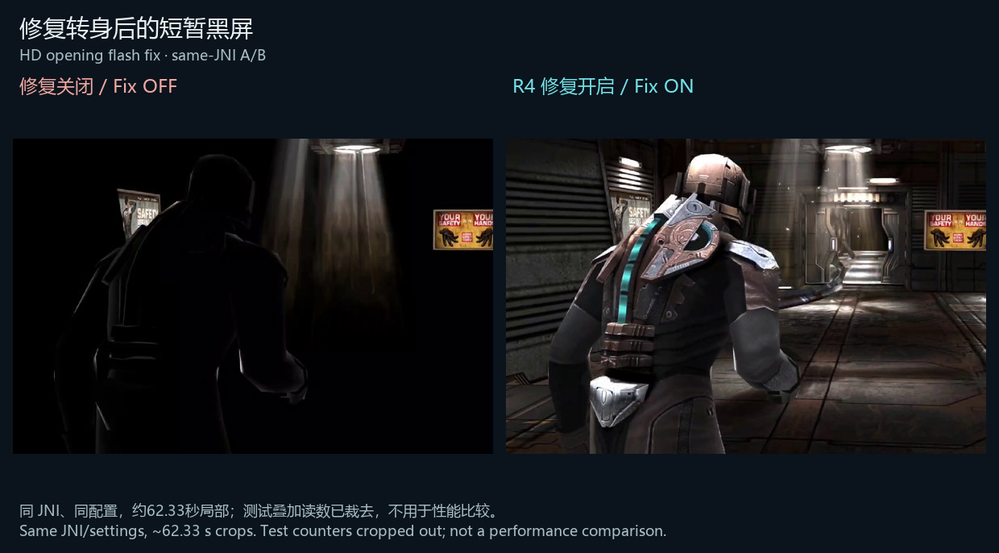

修复 PC 覆盖安装后直接报错、HD 开局主角转身后进入操作前短暂黑屏，以及安卓正常触摸定位器重复显示旧样式。修复高档渲染路径的开局黑面遮挡，补齐指定泰勒/主角代号闲谈的缺失字幕轨道。

- 新增独立**高级光影**开关，恢复原生高档反光和动态灯光等效果：普通 APK 默认关闭，HD／PC 默认开启，已有显式选择保留。
- 第一次点击“启动游戏”时复核**高清中文文字组件、高级光影、内部分辨率**，PC 另有**输出分辨率**；可返回设置，确认后保存。
- 安卓将上述重要设置前移，丰富左侧导航，移除“推荐画质／性能”等画质预设按钮。
- 中英双语。English 用户可关闭高清中文组件，沿用游戏原生文字和语言设置。欢迎多语言投稿；若无投稿，计划在 **R8 之前**支持其他语言的高清文字组件。
- PC 继续兼容原有 marker，**不需要新 marker**。保留 R2 的难度页手柄高亮与存档编辑修复，以及安卓 R3 主副模式切换默认关闭的行为。

### 局部对比 / Detail comparisons

盔甲反光：低档路径与高级光影。真实运行截图，同一开局区域，录制时刻和姿态有差异。

开局遮挡：同一二进制、同一配置，仅切换修复；独立录制，非逐帧同步。

开局短闪：同一 JNI、同一配置，在约62.33秒截取局部。测试计数器已裁去，不用于比较性能。所有图仅裁剪、缩放、标注，未调亮或修改游戏画面。

### 下载与验证

PC 下载 `*PC-Setup-20261112-R4-FIX.exe`。安卓普通版下载 `*DATA-20261112-R4.apk`，高清贴图版下载 `*HD-20261112-R4.apk`。本次包含经过回归验证的正常完整构建；SHA-256 和对应源码/构建输入随附件提供。PC 已在隔离旧 R4 上完成真实覆盖安装及启动，安卓实机验证采用独立测试包，正常主 APK 内容/签名及同 JNI 已核对。

全游戏长测、多硬件、全武器/音频和最终人工验收继续进行；本次不宣称所有高级效果在全部章节均已逐项验证。问题请提交至 [Community Issues](https://github.com/SomJsA/DeadSpaceMobile-Community/issues)。

### English

Fixes the PC crash after an upgrade, the brief HD blackout after the protagonist turns, and old-style objective replay when using Android's native touch locator. Fixes opening occlusion in the high-tier renderer and supplements the missing Tyler/protagonist codename banter subtitle tracks.

Independent advanced lighting restores native high-tier reflections and dynamic lighting: OFF by default in the standard APK, ON in HD and PC. Explicit saved choices are preserved. The first Launch click reviews HD Chinese text, lighting, internal resolution and PC output resolution. Android puts these controls first, expands the sidebar and removes recommended/performance quality preset buttons.

Disable HD Chinese components to use the game's native text and language settings. Other-language contributions are welcome; without submissions, HD text in other languages is planned before R8. Existing markers remain compatible. Earlier controller-highlight, save-editor and Android R3 default-off gesture fixes are retained.

The comparisons are actual cropped captures with bilingual labels, without brightness edits. Lighting captures differ in moment/pose; opening comparisons use the same binary/JNI and settings with the relevant fix toggled. These images do not compare performance. Full-game, sustained and additional-hardware acceptance remains open.
